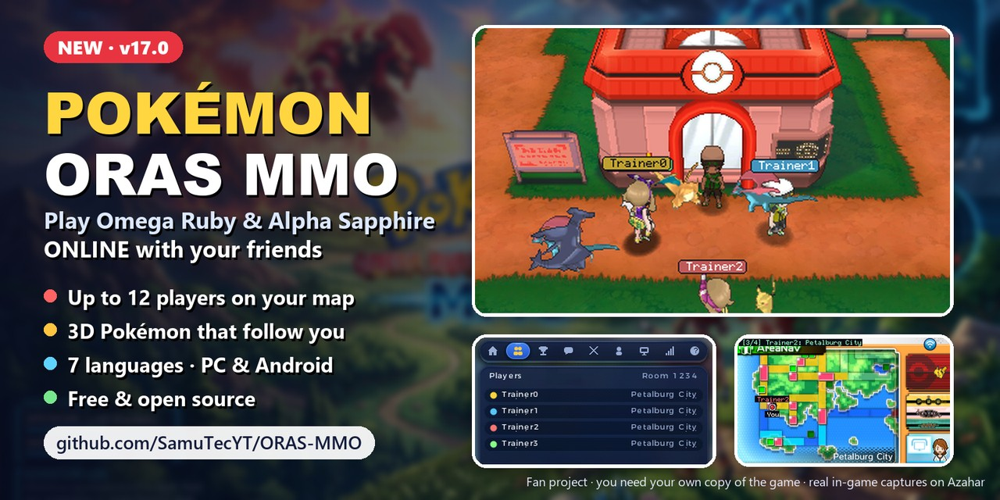
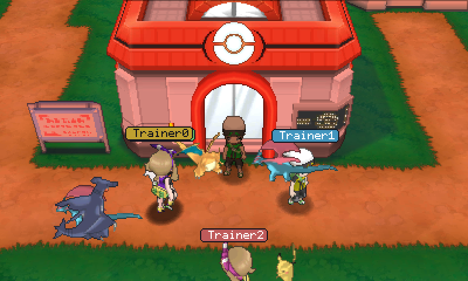
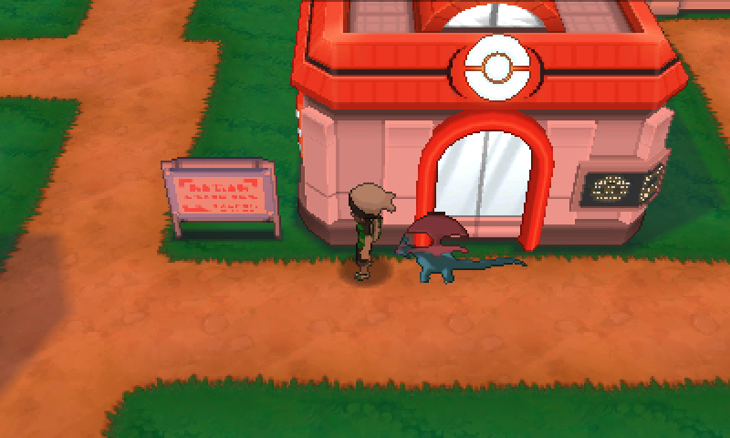
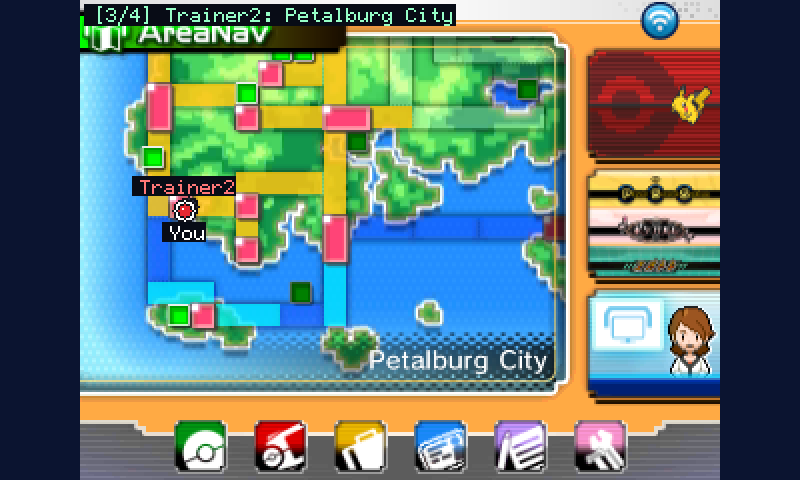
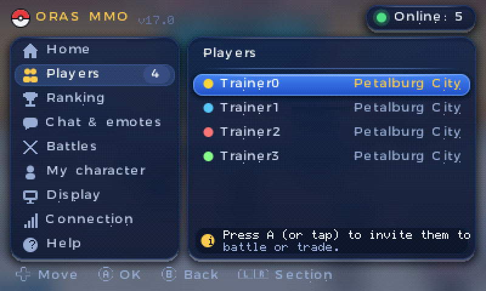
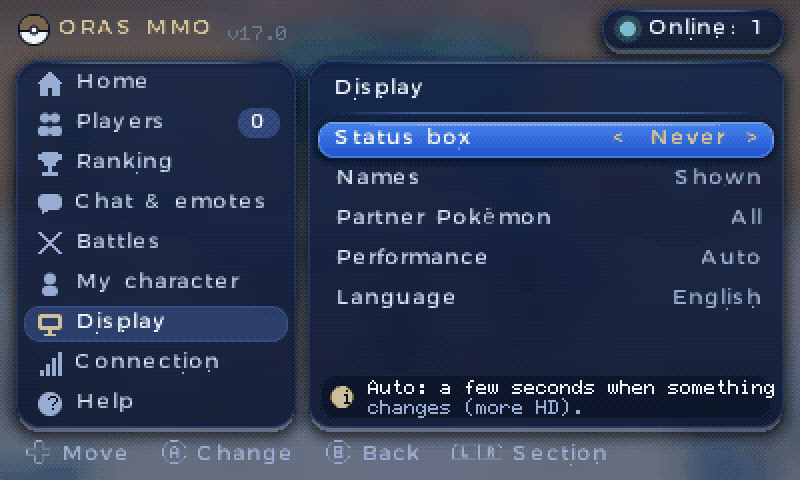
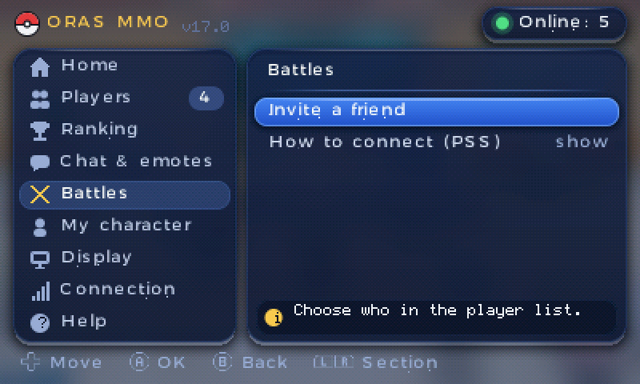
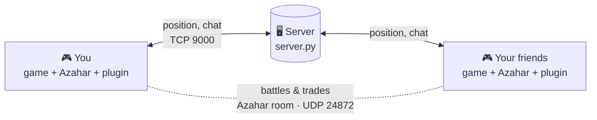

<p align="center">
  <a href="https://github.com/SamuTecYT/ORAS-MMO/releases/latest">
    
  </a>
</p>

<h1 align="center">Pokémon ORAS MMO</h1>

<p align="center">
  <b>Your friends, inside your own game.</b><br/>
  Play Pokémon Omega Ruby &amp; Alpha Sapphire online, together and in real time,
  on the <a href="https://azahar-emu.org">Azahar</a> emulator for PC and Android.
</p>

<p align="center">
  <a href="https://github.com/SamuTecYT/ORAS-MMO/releases/latest"></a>
  <a href="LICENSE"></a>
  
  
</p>
<p align="center">
  
  
  
  
  
  
</p>

<p align="center">
  <a href="#quick-start"><b>🚀 Quick start</b></a> &nbsp;·&nbsp;
  <a href="#play-with-friends-far-away"><b>🌍 Friends far away</b></a> &nbsp;·&nbsp;
  <a href="#3d-followers"><b>🐉 3D followers</b></a> &nbsp;·&nbsp;
  <a href="#troubleshooting"><b>🩺 Help</b></a> &nbsp;·&nbsp;
  <a href="#developers"><b>🛠️ Developers</b></a> &nbsp;·&nbsp;
  <a href="README_ES.md"><b>🇪🇸 Español</b></a>
</p>

---

<a id="what-you-get"></a>
## ✨ What you get

<table>
  <tr>
    <td width="50%" valign="top">
      
      <h3>👥 Your friends, in your world</h3>
      Up to <b>12 players per room</b>, shown with the game's real 3D Brendan and May models. They walk, run and
      ride the Mach or Acro bike, and move smoothly even on a bad connection.
    </td>
    <td width="50%" valign="top">
      
      <h3>🐉 3D Pokémon that follow you</h3>
      Your lead Pokémon walks behind you, and so do your friends'. They go around houses and trees, and they hide
      behind buildings. <a href="#3d-followers">One-time setup</a>.
    </td>
  </tr>
  <tr>
    <td width="50%" valign="top">
      
      <h3>🗺️ Friends on the game's own map</h3>
      See where everyone is on the <b>AreaNav</b> and the <b>Fly map</b>, right on the touch screen.
    </td>
    <td width="50%" valign="top">
      
      <h3>📱 One menu for everything</h3>
      Press <b>SELECT</b>: players online, chat, whispers, emotes, ranking, your outfit colors and settings.
      Works with mouse, touch screen or buttons.
    </td>
  </tr>
  <tr>
    <td width="50%" valign="top">
      
      <h3>🌐 7 languages, the whole game</h3>
      English, Spanish, French, Italian, German, Japanese and Korean, for the MMO menu <b>and</b> the game itself.
    </td>
    <td width="50%" valign="top">
      
      <h3>⚔️ Real battles and trades</h3>
      Invite a friend from the menu and battle or trade for real, through Azahar's own multiplayer room.
    </td>
  </tr>
</table>

**And also:** 🏆 a ranking per room (badges, League, Pokédex, team) · 💬 quick messages and emotes ·
🔄 PC and Android in the same room · 💾 **your save is never modified**.

<a id="what-do-you-want-to-do"></a>
## 🧭 What do you want to do?

| 🎮 **Play** | 🏠 **Host for my friends** | 🛠️ **Code** |
|---|---|---|
| Install it in 5 minutes and join a server. | Run the free server on your PC or on a VPS. | Build it, change it and share your own version. |
| 👉 [Quick start](#quick-start) | 👉 [Host a server](#host-a-server) | 👉 [Developers](#developers) |

<a id="how-it-works"></a>
## 🔌 How it works



- The **plugin** (`OrasMmo.3gx`) runs inside the game: it reads where you are and draws your friends, their
  Pokémon and the menu.
- The **server** (`server/server.py`) just passes messages between the players of each room. Anyone can host one:
  there is **no central server** and no account.
- The server never sees your save. It only gets what the plugin sends: nickname, model, position, chat, emotes and
  ranking stats.

<a id="quick-start"></a><a id="quick-start-players"></a>
## 🚀 Quick start

### ✅ What you need

- [ ] **[Azahar](https://azahar-emu.org)** (latest version), on PC or Android.
- [ ] **Your own copy** of Pokémon Omega Ruby or Alpha Sapphire, **already working in Azahar**.
- [ ] The **address of a server**: a friend's, a VPS, or your own PC ([how to host one](#host-a-server)).

> [!IMPORTANT]
> There are no games here. You need your own copy, already running in Azahar. Azahar's website explains how to dump
> your own cartridge.

### 🪟 Windows (easiest)

1. **Download** `ORAS_MMO_v17.0_Global.zip` from
   [the latest release](https://github.com/SamuTecYT/ORAS-MMO/releases/latest) and extract it
   (right click → *Extract all*).
2. **Double-click `INSTALL_PC.bat`.** It finds Azahar, installs the plugin for both games and asks for the server
   address. Type it like `203.0.113.10` or `203.0.113.10:9000`. Leave it empty if the server runs on this same PC.
3. **In Azahar**, turn on the plugin loader once: **Emulation → Configure → System** (or **Debug**) →
   ✅ **3GX plugin loader**.
4. **Start the game**, load your save and press **SELECT**. That's it! 🎉

<details>
<summary><b>🤖 Android</b></summary>

1. Extract the ZIP on your phone (or on a PC and copy the files over).
2. With a file manager, open Azahar's data folder → `sdmc/luma/plugins/`. Create `luma` and `plugins` if they don't
   exist.
3. Copy `OrasMmo.3gx` there and **rename it to `default.3gx`**.
4. In the same folder, create a text file named `mmo_server.txt` with the server address inside (for example
   `203.0.113.10`).
5. In Azahar: **Settings → System** → ✅ **3GX plugin loader**, and **Settings → Graphics** → **OpenGL ES**.
6. Start the game and tap **SELECT** (the bottom screen is touch-enabled).

</details>

<details>
<summary><b>🐧 Linux / 🍎 macOS (or installing by hand)</b></summary>

1. In Azahar, open **File → Open Azahar Folder**. It is usually:
   - Windows: `%APPDATA%\Azahar`
   - Linux: `~/.local/share/azahar-emu`
   - macOS: `~/Library/Application Support/Azahar`
2. Copy `OrasMmo.3gx` into the folder of your game (create the folders if they don't exist):
   - Omega Ruby: `sdmc/luma/plugins/000400000011C400/`
   - Alpha Sapphire: `sdmc/luma/plugins/000400000011C500/`
3. In that same folder, create `mmo_server.txt` with the server address (for example `203.0.113.10` or
   `203.0.113.10:9000`).
4. Turn on **3GX plugin loader** in Azahar's settings, start the game and press **SELECT**.

</details>

### 🤝 Play together

- Everyone uses the **same server** and the **same room code** (SELECT → **Connection**; the default is `1234`).
- **Battles and trades:** send the invitation from SELECT → **Battles**. Then both of you join the same Azahar room
  (**Multiplayer → Direct Connect**) and open the **PSS** on the touch screen.
- **No server yet?** One of you can host it at home for free → [Play with friends far away](#play-with-friends-far-away).

> [!TIP]
> Pick your own room code, something hard to guess like `Hoenn-Crew-77`. The room code is what keeps strangers out
> of your room.

<a id="3d-followers"></a>
## 🐉 Turn on the 3D followers (one-time setup)

The followers are drawn from a file called `mmo_pokes_3d.bin`. It is made from the game's own 3D models, so it
**can't be shared here**: you create it once from **your own copy** of the game, on a PC (Windows, Linux or macOS).
Everything else works without it. Android players can copy the file made on a PC.

1. Install **[Python 3.10 or newer](https://www.python.org/downloads/)** (Windows: tick ✅ *Add Python to PATH*).
2. Download this repository (green **Code** button → **Download ZIP**) and open a terminal in `tools/pokepack`.
3. Run these two commands, with the path to the game file Azahar runs (a decrypted `.3ds`, `.cci` or `.cxi`):
   ```bash
   python -m pip install -r requirements.txt
   python make_3d_pack.py --rom "C:\path\to\your_game.3ds"
   ```
4. Wait about **10 minutes**. You get `mmo_pokes_3d.bin` (about 31 MB).
5. Put it **next to the plugin** (the same folder as `OrasMmo.3gx`, or `default.3gx` on Android) and restart the
   game. On Windows you can also drop it next to `INSTALL_PC.bat` and run the installer again.

> [!NOTE]
> Keep `mmo_pokes_3d.bin` for yourself: it contains game graphics, so don't upload or share it. Full guide and
> options: [tools/pokepack](tools/pokepack/README.md).

<a id="the-select-menu"></a>
## 📱 The SELECT menu

Press **SELECT** in the game (on Android, the on-screen SELECT button). Mouse, touch screen and buttons all work.

| | Section | What you do there |
|:---:|---|---|
| 🏠 | **Home** | Connection status, your room and where you are, plus shortcuts |
| 👥 | **Players** | Everyone in your room and where they are; pick someone to whisper to or invite |
| 🏆 | **Ranking** | The room's table: badges, League, Pokédex and team (offline players included) |
| 💬 | **Chat & emotes** | Quick messages, free text, whispers and emotes (`!`, happy, heart, laugh…) |
| ⚔️ | **Battles** | Invite someone to battle or trade; watch a friend's battle live |
| 🎨 | **My character** | Outfit color (16), hat or bow color, name tag color, with a preview |
| 🖥️ | **Display** | Names, followers (all / mine / none), performance (auto / quality / saver), **language** |
| 📶 | **Connection** | Your name, room code, server, reconnect |
| ❓ | **Help** | Short guides inside the game |

<a id="play-with-friends-far-away"></a><a id="play-online-without-a-rented-server"></a>
## 🌍 Play with friends far away (no rented server)

You don't need to pay for a server. One player, the **host**, runs the server on their own PC, and friends anywhere
in the world connect to it through a free **virtual network**. The host's PC must stay on while you play.

### 1️⃣ The host starts the server

1. Install [Python 3](https://www.python.org/downloads/) (Windows: tick ✅ *Add Python to PATH*).
2. Double-click `server/run_server.bat` (Linux/macOS: `python3 server/server.py`) and **leave the window open**.
3. When Windows asks, **allow Python on private and public networks** (virtual networks often count as "public").
4. The host plays on the same PC with the default server `127.0.0.1`: nothing to change.

<details>
<summary>🧱 Firewall rule, if Windows didn't ask (run in a terminal opened as administrator)</summary>

```bat
netsh advfirewall firewall add rule name="ORAS MMO" dir=in action=allow protocol=TCP localport=9000
```

</details>

### 2️⃣ Connect your friends: pick one

| | 💸 Free | 🤖 Android | 👤 Account | ✅ Best for |
|---|:---:|:---:|:---:|---|
| **ZeroTier** | ✅ | ✅ | host only | Groups with Android players (this project started with it) |
| **Tailscale** | ✅ personal use | ✅ | everyone | Easy setup if everyone already has Google/Microsoft/GitHub |
| **Radmin VPN** | ✅ | ❌ | none | Windows-only groups, the simplest |
| **Router port** | ✅ | ✅ | none | If you can change your router's settings |

<details>
<summary><b>🟠 ZeroTier</b> — step by step</summary>

1. The host creates a free account at [my.zerotier.com](https://my.zerotier.com), clicks **Create A Network** and
   copies the **Network ID** (16 characters). Leave **Access Control** on **Private**.
2. Everyone (the host too) installs [ZeroTier One](https://www.zerotier.com/download/) and **joins** that Network ID
   (Windows: tray icon → *Join New Network*; Android: the **+** button).
3. On the network page, under **Members**, the host ticks **Auth** for each friend. Only people you know!
4. The host's **Managed IP** in that list (for example `10.147.17.5`) is the server address for everyone else.

</details>

<details>
<summary><b>🔵 Tailscale</b> — step by step</summary>

1. Everyone installs [Tailscale](https://tailscale.com/download) and signs in.
2. The host shares their PC with each friend (admin console → the machine → **Share**) or invites them to the
   tailnet.
3. The host's **Tailscale IP** (`100.x.y.z`, shown in the app) is the server address.

</details>

<details>
<summary><b>🟢 Radmin VPN</b> — step by step (Windows only)</summary>

1. Everyone installs [Radmin VPN](https://www.radmin-vpn.com/) (no account needed).
2. The host creates a network with a name and a password; friends join it with **Join network**.
3. The host's `26.x.x.x` IP, shown in Radmin, is the server address.

</details>

<details>
<summary><b>🌐 Router port</b> — no extra program</summary>

1. In the host's router, forward **TCP 9000** to the host PC's local IP.
2. Give your friends your **public IP** (search "what is my IP").

> If your internet provider uses CGNAT, this won't work: use a virtual network instead.

</details>

> [!WARNING]
> With a router port, your friends learn your home IP, and that IP can change. Virtual networks avoid both and
> encrypt the traffic. In any case, only let in people you trust.

### 3️⃣ Every friend types the host's address

SELECT → **Connection → Server** → the host's IP (virtual network IP or public IP). Or put it in `mmo_server.txt`
next to the plugin (on Windows, `INSTALL_PC.bat` asks for it). Everyone uses the **same room code**.

### 4️⃣ Battles and trades (optional)

The host opens an Azahar room: **Multiplayer → Host Room** (port **24872**, set a password). Friends use
**Multiplayer → Direct Connect** with the host's same IP and port 24872. With a router port, also forward
**UDP 24872**.

<details>
<summary>🧱 Firewall rule for the Azahar room</summary>

```bat
netsh advfirewall firewall add rule name="Azahar room" dir=in action=allow protocol=UDP localport=24872
```

</details>

> [!TIP]
> **Someone can't connect?** The server window shows a line for every player who joins. Check the firewall rule,
> that ZeroTier or Tailscale says *connected* on both sides (and the friend is authorized), the IP, and the room code.

<a id="host-a-server"></a><a id="host-your-own-server"></a>
## 🏠 Host a server

The server is one Python file with **no dependencies**. Full guide (Windows, Linux VPS, Docker, always-on, limits):
**[server/README.md](server/README.md)**.

```bash
cd server
python3 server.py              # listens on TCP 9000
PORT=9100 python3 server.py    # another port (players then use "IP:9100")
docker compose up -d           # or with Docker (copy .env.example to .env first)
```

Open **TCP 9000** (and **UDP 24872** if you also host the Azahar room) on your router or hosting panel.

<a id="configuration-files"></a>
## ⚙️ Configuration files

Most players never touch these: the SELECT menu writes them for you. They live next to the plugin.

| File | What it is | Example |
|---|---|---|
| `mmo_server.txt` | Server address: an IPv4, optionally with `:port` (no domain names) | `203.0.113.10:9000` |
| `mmo_room.txt` | Room code (1–16 characters) | `Hoenn-Crew-77` |
| `mmo_name.txt` | Your nickname (up to 13 characters) | `Ash` |
| `mmo_key.txt` | Your secret ranking key, so nobody else can use your nickname to change your stats. Don't share it; copy it to play on another device | written by the plugin |
| `mmo_settings.txt` | Everything you set in the SELECT menu | written by the plugin |
| `mmo_pokes_3d.bin` | 3D followers pack (optional) | [how to make it](#3d-followers) |
| `mmo_log.txt` | Log, useful for bug reports | written by the plugin |

<a id="troubleshooting"></a>
## 🩺 Troubleshooting

| 😕 Problem | 💡 Try this |
|---|---|
| Nothing happens when I press SELECT | Turn on Azahar's **3GX plugin loader**. Check the plugin is in `sdmc/luma/plugins/000400000011C400/` (Omega Ruby) or `.../000400000011C500/` (Alpha Sapphire), or is `plugins/default.3gx` on Android. Restart the game. |
| I don't see my friends | Everyone needs the **same server and the same room code**. The server window must be open. Try SELECT → Connection → Reconnect, and check the host's firewall. |
| The menu says "Disconnected" | Wrong IP or port, the server is off, or a firewall blocks TCP 9000. |
| No Pokémon follow us | You need `mmo_pokes_3d.bin` → [3D followers](#3d-followers). |
| The game runs slowly | SELECT → Display → Performance → **Saver**. On Android, use **OpenGL ES**. |
| I found a bug | [Open an issue](https://github.com/SamuTecYT/ORAS-MMO/issues/new/choose) and attach `mmo_log.txt`. Remove your server IP and room code from it first. |

<a id="faq"></a>
## ❓ FAQ

<details>
<summary><b>Does it change my save file?</b></summary>

No. The plugin reads the game's memory and only changes a few visual things while you play (your outfit color, your
friends' models, the game language). Your save is never modified.

</details>

<details>
<summary><b>How do I play in Japanese or Korean?</b></summary>

SELECT → **Display → Language**. The MMO menu changes at once; the game's own texts change after you restart the
game.

</details>

<details>
<summary><b>The menu says "Server: Automatic". What is that?</b></summary>

It is the default server built into the plugin: `127.0.0.1`, which means "this same PC". Set your server in
SELECT → **Connection**, or with `mmo_server.txt`.

</details>

<details>
<summary><b>Does it work on a real 3DS?</b></summary>

It is built and tested on Azahar. A real console with Luma3DS's plugin loader might work, but it is untested.

</details>

<details>
<summary><b>What if I have another version of the game?</b></summary>

The plugin checks the game version when it starts. If it doesn't match, it turns off the parts that touch the game's
memory instead of crashing.

</details>

<details>
<summary><b>Is it free? Can I use it for my own community?</b></summary>

Yes and yes. It is free and open source (MIT). Host your own server, and if you want, build a version that connects
to it automatically → [Developers](#developers).

</details>

<a id="developers"></a><a id="build-from-source"></a><a id="make-it-yours-developers"></a>
## 🛠️ Developers

Want to improve it or make your own version? Welcome! 🙌 Start with **[docs/ARCHITECTURE.md](docs/ARCHITECTURE.md)**
(how the plugin is organized and the rules that keep it stable) and **[CONTRIBUTING.md](CONTRIBUTING.md)**.

### 🔨 Build the plugin

You need [devkitPro](https://devkitpro.org/wiki/Getting_Started) with **devkitARM** (r68) and **libctru** (2.7), plus
**libctrpf** 0.8 (CTRPluginFramework) and **3gxtool** 1.3 from the
[CTRPluginFramework](https://gitlab.com/thepixellizeross/ctrpluginframework) package repository.

```bash
cd 3ds_plugin
make        # -> 3ds_plugin.3gx (rename it to OrasMmo.3gx)
```

<details>
<summary>📦 How to install libctrpf and 3gxtool</summary>

Add these repositories to devkitPro's `pacman.conf` (Windows: `C:\devkitPro\msys2\etc\pacman.conf`; Linux: the
file `dkp-pacman -v -Q` shows as *Conf File*). Use `win` on Windows and `linux` on Linux:

```ini
[thepixellizeross-lib]
Server = https://thepixellizeross.gitlab.io/packages/any
SigLevel = Optional

[thepixellizeross-win]
Server = https://thepixellizeross.gitlab.io/packages/x86_64/win
SigLevel = Optional
```

Then run `pacman -Sy libctrpf 3gxtool` (on Linux, `dkp-pacman`). The workflow in
[.github/workflows/build.yml](.github/workflows/build.yml) does exactly this on Linux.

</details>

> [!TIP]
> **No toolchain?** In your fork, open **Actions → Build plugin and test server → Run workflow**. It runs the server
> tests and gives you the public `OrasMmo.3gx` to download (kept for 30 days).

- **Windows:** devkitPro's `make` breaks with spaces in the path; build from a folder like `C:\dev\ORAS-MMO`.
- Flags: `-Os -std=gnu++11 -fno-rtti -fno-exceptions`; plugin memory `10MiB` (`CTRPluginFramework.plgInfo`).
- **Translations** live in `3ds_plugin/tools/i18n/strings.py`. After editing, run
  `python 3ds_plugin/tools/i18n/gen_lang.py` (it regenerates `Includes/LangTable.inc` and checks `%s` / `%d`).
- **Server tests:** `python -m unittest server/test_server_ranking.py server/test_server_limits.py`.
- **Release ZIP:** `python tools/package_public.py path/to/OrasMmo.3gx` → `dist/ORAS_MMO_v17.0_Global.zip`.

### 🎯 Make it yours

- **Your server by default:** copy `3ds_plugin/Includes/ServerConfig.example.hpp` to `ServerConfig.local.hpp` and
  set your IP, port and room. That file is **git-ignored**: your build connects on its own, and your address never
  ends up in a public repository. Without it, the plugin uses `127.0.0.1:9000`, room `1234`.
- **Private server:** `ORAS_ROOMS=MyRoom,OtherRoom` makes the server accept only those rooms.
- **Network protocol:** 64-byte packets, documented in **[docs/PROTOCOL.md](docs/PROTOCOL.md)**. Write your own
  server or tools against it.
- **Before publishing a fork:** `python tools/prepublish_check.py` looks for your private data (IPs, names,
  passwords listed in a git-ignored `.private_patterns.txt`) and for files that must never be shared
  (`mmo_pokes_*.bin`, ZIPs, rankings, `.env`).
- Code comments cite `KB §x.y`: the project's reverse-engineering notes about game addresses. They are not part of
  this repository; the values themselves are in the code.

<details>
<summary><b>🗂️ Project layout</b></summary>

```
3ds_plugin/            The 3GX plugin (C++ / CTRPluginFramework)
  Sources/, Includes/  Game reading, rendering, menu, network, languages
  tools/i18n/          Translations (strings.py) and table generator
server/                Relay server (server.py), tests, Docker files, hosting guide
packaging/             Files that go into the release ZIP (installer, quick start)
extras/shaders/        Optional post-processing shader for Azahar (OpenGL)
tools/                 package_public.py (release ZIP), prepublish_check.py, fake_players.py (test bots)
  pokepack/            Builds the 3D followers pack from your own game
docs/                  ARCHITECTURE.md (developer guide), PROTOCOL.md, img/ (README pictures)
CONTRIBUTING.md        How to contribute · SECURITY.md: how to report vulnerabilities
```

</details>

<a id="security-and-privacy"></a>
## 🔒 Security and privacy

- 🙅 **No accounts, no passwords, no tracking.** The plugin only talks to the server you choose.
- 📤 **What the server gets:** your nickname, trainer model, position, chat and emotes, invitations and ranking stats
  (badges, Pokédex, play time, team levels), plus a fingerprint of your ranking key (never the key). Like any online game server, it also sees your IP address.
- 🔑 **The room code is the key.** Anyone who knows your server and room code can join that room with any nickname.
  Use a private room code (or `ORAS_ROOMS`) and only share it with people you trust.

<details>
<summary>🛡️ What the server and the plugin do to stay safe</summary>

- The server checks the room code, sets each player's id itself (nobody can pretend to be another slot), limits every
  client's queue and enforces connection limits (in total, per IP, rooms and ranking files).
- Ranking files are named after the room code in hex, so a room code can never write outside the server folder.
- The first player who saves stats with a nickname owns it (`mmo_key.txt`): someone else with that nickname can't
  change or delete them and shows up as `nickname*`. Details in [PROTOCOL](docs/PROTOCOL.md#ranking-keys).
- Each player can send at most 120 packets per second (the plugin sends about 30). A flood is dropped, never relayed.
- The plugin checks everything it receives (player ids; text is always cut and terminated) and every file it reads
  (`mmo_*.txt` and the followers pack).

</details>

Found a vulnerability? Please report it **privately** with a
[security advisory](https://github.com/SamuTecYT/ORAS-MMO/security/advisories/new), not in a public issue.
More in [SECURITY.md](SECURITY.md).

<a id="contributing"></a>
## 🤝 Contributing

Bug reports, translations, ideas and pull requests are all welcome. Read **[CONTRIBUTING.md](CONTRIBUTING.md)** first.

<p align="center">
  ⭐ <b>If you like the project, give it a star!</b> It helps other trainers find it. ⭐
</p>

<a id="legal"></a>
## ⚖️ Legal

Pokémon ORAS MMO is a free, non-commercial fan project. It is not affiliated with or endorsed by Nintendo,
Creatures Inc. or GAME FREAK inc. Pokémon and all related names are trademarks of their respective owners. This
repository contains **no ROMs, no game code and no game files**: names, fonts, models and textures are read while you
play from **your own copy** of the game. Use it only with games you legally own.

Code under the [MIT License](LICENSE). Made with ❤️ by [SamuTecYT](https://github.com/SamuTecYT) and contributors.
