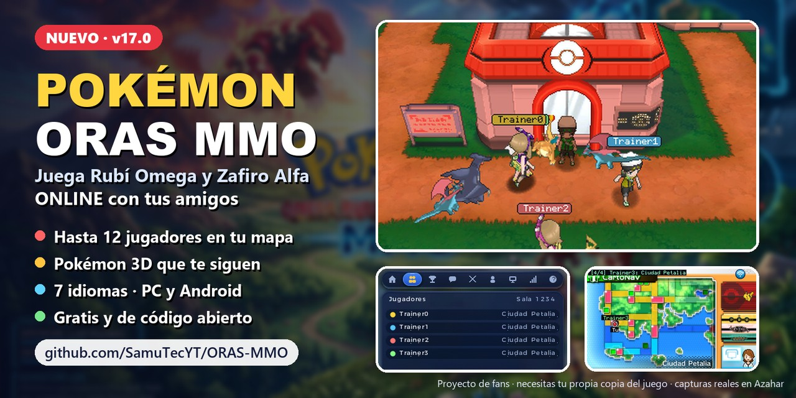
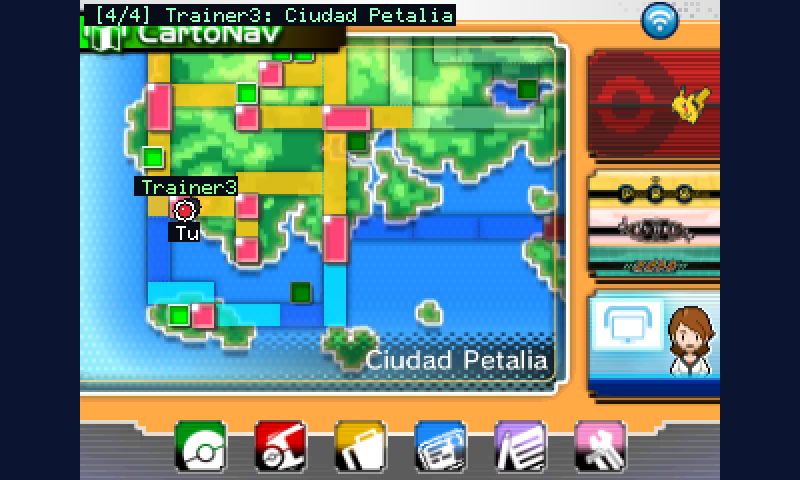
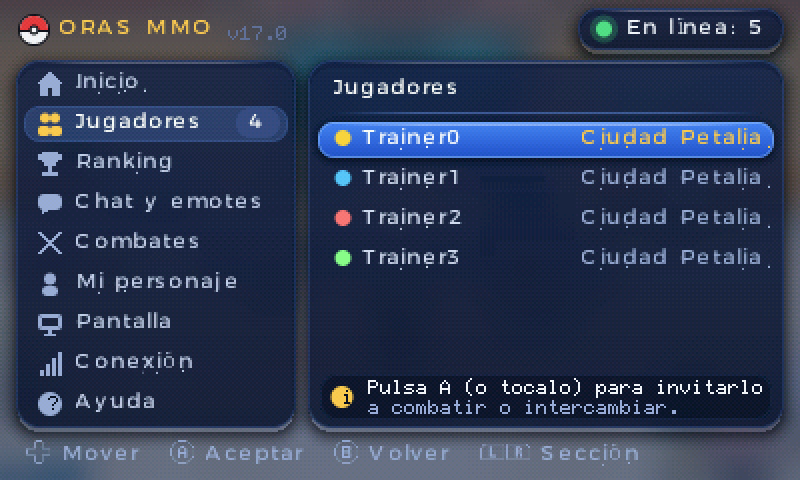
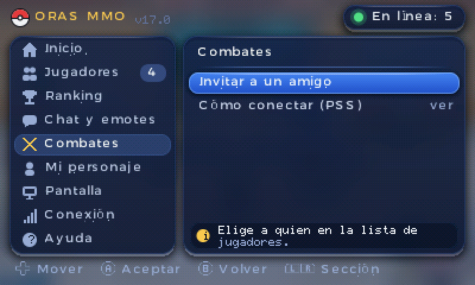
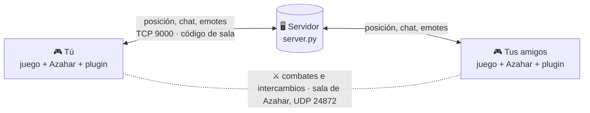

<p align="center">
  <a href="https://github.com/SamuTecYT/ORAS-MMO/releases/latest">
    
  </a>
</p>

<h1 align="center">Pokémon ORAS MMO</h1>

<p align="center">
  <b>Tus amigos, dentro de tu propio juego.</b><br/>
  Juega Pokémon Rubí Omega y Zafiro Alfa online, juntos y en tiempo real,
  en el emulador <a href="https://azahar-emu.org">Azahar</a> para PC y Android.
</p>

<p align="center">
  <a href="https://github.com/SamuTecYT/ORAS-MMO/releases/latest"></a>
  <a href="LICENSE"></a>
  
  
</p>
<p align="center">
  
  
  
  
  
  
</p>

<p align="center">
  <a href="#inicio-rapido"><b>🚀 Empezar</b></a> &nbsp;·&nbsp;
  <a href="#amigos-lejos"><b>🌍 Amigos lejos</b></a> &nbsp;·&nbsp;
  <a href="#acompanantes-3d"><b>🐉 Pokémon 3D</b></a> &nbsp;·&nbsp;
  <a href="#si-algo-falla"><b>🩺 Ayuda</b></a> &nbsp;·&nbsp;
  <a href="#programadores"><b>🛠️ Programadores</b></a> &nbsp;·&nbsp;
  <a href="README.md"><b>🇬🇧 English</b></a>
</p>

---

<a id="que-trae"></a>
## ✨ Qué trae

<table>
  <tr>
    <td width="50%" valign="top">
      
      <h3>👥 Tus amigos, en tu mundo</h3>
      Hasta <b>12 jugadores por sala</b>, con los modelos 3D reales de Bruno y Aura. Caminan, corren y van en la
      bici Carrera o Acrobática, y se mueven suave aunque la conexión sea mala.
    </td>
    <td width="50%" valign="top">
      
      <h3>🐉 Pokémon 3D que te siguen</h3>
      Tu primer Pokémon camina detrás de ti, y los de tus amigos también. Rodean casas y árboles, y se esconden
      detrás de los edificios. <a href="#acompanantes-3d">Se activa una sola vez</a>.
    </td>
  </tr>
  <tr>
    <td width="50%" valign="top">
      
      <h3>🗺️ Tus amigos en el mapa del juego</h3>
      Mira dónde está cada uno en el <b>CartoNav</b> y en el <b>mapa de Vuelo</b>, en la pantalla táctil.
    </td>
    <td width="50%" valign="top">
      
      <h3>📱 Un menú para todo</h3>
      Pulsa <b>SELECT</b>: jugadores conectados, chat, susurros, emotes, ranking, los colores de tu ropa y los
      ajustes. Con ratón, pantalla táctil o botones.
    </td>
  </tr>
  <tr>
    <td width="50%" valign="top">
      
      <h3>🌐 7 idiomas, todo el juego</h3>
      Español, inglés, francés, italiano, alemán, japonés y coreano, para el menú del MMO <b>y</b> para el juego.
    </td>
    <td width="50%" valign="top">
      
      <h3>⚔️ Combates e intercambios de verdad</h3>
      Invita a un amigo desde el menú y combatan o intercambien de verdad, con la sala multijugador de Azahar.
    </td>
  </tr>
</table>

**Y además:** 🏆 ranking por sala (medallas, Liga, Pokédex, equipo) · 💬 mensajes rápidos y emotes ·
🔄 PC y Android en la misma sala · 💾 **tu partida nunca se modifica**.

<a id="que-quieres-hacer"></a>
## 🧭 ¿Qué quieres hacer?

| 🎮 **Jugar** | 🏠 **Montar un servidor para mis amigos** | 🛠️ **Programar** |
|---|---|---|
| Instálalo en 5 minutos y entra en un servidor. | Abre el servidor gratis en tu PC o en un VPS. | Compílalo, cámbialo y comparte tu versión. |
| 👉 [Empezar a jugar](#inicio-rapido) | 👉 [Monta un servidor](#monta-un-servidor) | 👉 [Programadores](#programadores) |

<a id="como-funciona"></a>
## 🔌 Cómo funciona



- El **plugin** (`OrasMmo.3gx`) funciona dentro del juego: lee dónde estás y dibuja a tus amigos, sus Pokémon y el
  menú.
- El **servidor** (`server/server.py`) solo pasa los mensajes entre los jugadores de cada sala. Cualquiera puede
  montar uno: **no hay servidor central** ni cuentas.
- El servidor nunca ve tu partida. Solo recibe lo que manda el plugin: apodo, modelo, posición, chat, emotes y datos
  del ranking.

<a id="inicio-rapido"></a><a id="empezar-a-jugar"></a>
## 🚀 Empezar a jugar

### ✅ Qué necesitas

- [ ] **[Azahar](https://azahar-emu.org)** (la última versión), en PC o Android.
- [ ] **Tu propia copia** de Pokémon Rubí Omega o Zafiro Alfa, **ya funcionando en Azahar**.
- [ ] La **dirección de un servidor**: el de un amigo, un VPS o tu propio PC ([cómo montar uno](#monta-un-servidor)).

> [!IMPORTANT]
> Aquí no hay juegos. Necesitas tu propia copia, ya funcionando en Azahar. En la web de Azahar se explica cómo volcar
> tu propio cartucho.

### 🪟 Windows (lo más fácil)

1. **Descarga** `ORAS_MMO_v17.0_Global.zip` de
   [la última versión](https://github.com/SamuTecYT/ORAS-MMO/releases/latest) y extráelo
   (clic derecho → *Extraer todo*).
2. **Doble clic en `INSTALL_PC.bat`.** Busca Azahar, instala el plugin para los dos juegos y te pide la dirección
   del servidor. Escríbela así: `203.0.113.10` o `203.0.113.10:9000`. Déjala vacía si el servidor está en este mismo
   PC.
3. **En Azahar**, activa una sola vez el cargador de plugins: **Emulación → Configurar → Sistema** (o
   **Depuración**) → ✅ **cargador de plugins 3GX**.
4. **Abre el juego**, carga tu partida y pulsa **SELECT**. ¡Listo! 🎉

<details>
<summary><b>🤖 Android</b></summary>

1. Extrae el ZIP en el móvil (o en un PC y pasa los archivos).
2. Con un explorador de archivos, abre la carpeta de datos de Azahar → `sdmc/luma/plugins/`. Crea `luma` y
   `plugins` si no existen.
3. Copia ahí `OrasMmo.3gx` y **cámbiale el nombre a `default.3gx`**.
4. En esa misma carpeta, crea un archivo de texto llamado `mmo_server.txt` con la dirección del servidor dentro (por
   ejemplo `203.0.113.10`).
5. En Azahar: **Ajustes → Sistema** → ✅ **cargador de plugins 3GX**, y **Ajustes → Gráficos** → **OpenGL ES**.
6. Abre el juego y toca **SELECT** (la pantalla de abajo es táctil).

</details>

<details>
<summary><b>🐧 Linux / 🍎 macOS (o instalarlo a mano)</b></summary>

1. En Azahar, abre **Archivo → Abrir carpeta de Azahar**. Normalmente es:
   - Windows: `%APPDATA%\Azahar`
   - Linux: `~/.local/share/azahar-emu`
   - macOS: `~/Library/Application Support/Azahar`
2. Copia `OrasMmo.3gx` en la carpeta de tu juego (crea las carpetas si no existen):
   - Rubí Omega: `sdmc/luma/plugins/000400000011C400/`
   - Zafiro Alfa: `sdmc/luma/plugins/000400000011C500/`
3. En esa misma carpeta, crea `mmo_server.txt` con la dirección del servidor (por ejemplo `203.0.113.10` o
   `203.0.113.10:9000`).
4. Activa el **cargador de plugins 3GX** en los ajustes de Azahar, abre el juego y pulsa **SELECT**.

</details>

### 🤝 Jugar juntos

- Todos usan el **mismo servidor** y el **mismo código de sala** (SELECT → **Conexión**; por defecto es `1234`).
- **Combates e intercambios:** manda la invitación desde SELECT → **Combates**. Después, los dos entran en la misma
  sala de Azahar (**Multijugador → Conectarse directamente**) y abren el **PSS** en la pantalla táctil.
- **¿Aún no tienen servidor?** Uno de ustedes puede montarlo en casa gratis → [Jugar con amigos lejos](#amigos-lejos).

> [!TIP]
> Elige tu propio código de sala, uno difícil de adivinar como `Hoenn-Crew-77`. El código de sala es lo que deja
> fuera de tu sala a los desconocidos.

<a id="acompanantes-3d"></a>
## 🐉 Activa los Pokémon 3D que te siguen (una sola vez)

Los acompañantes salen de un archivo llamado `mmo_pokes_3d.bin`. Se hace con los modelos 3D del propio juego, así que
**no se puede compartir aquí**: lo creas una vez desde **tu propia copia** del juego, en un PC (Windows, Linux o
macOS). Todo lo demás funciona sin él. Si juegas en Android, copia el archivo creado en un PC.

1. Instala **[Python 3.10 o más nuevo](https://www.python.org/downloads/)** (en Windows, marca ✅ *Add Python to
   PATH*).
2. Descarga este repositorio (botón verde **Code** → **Download ZIP**) y abre una terminal en `tools/pokepack`.
3. Ejecuta estos dos comandos, con la ruta del archivo del juego que abre Azahar (un `.3ds`, `.cci` o `.cxi`
   descifrado):
   ```bash
   python -m pip install -r requirements.txt
   python make_3d_pack.py --rom "C:\ruta\a\tu_juego.3ds"
   ```
4. Espera unos **10 minutos**. Obtienes `mmo_pokes_3d.bin` (unos 31 MB).
5. Ponlo **junto al plugin** (en la misma carpeta que `OrasMmo.3gx`, o `default.3gx` en Android) y reinicia el juego.
   En Windows también puedes dejarlo junto a `INSTALL_PC.bat` y volver a abrir el instalador.

> [!NOTE]
> Guarda `mmo_pokes_3d.bin` solo para ti: lleva gráficos del juego, así que no lo subas ni lo compartas. Guía
> completa y opciones: [tools/pokepack](tools/pokepack/README_ES.md).

<a id="el-menu-select"></a>
## 📱 El menú SELECT

Pulsa **SELECT** en el juego (en Android, el botón SELECT de la pantalla). Funciona con ratón, pantalla táctil o
botones.

| | Sección | Qué haces ahí |
|:---:|---|---|
| 🏠 | **Inicio** | Estado de la conexión, tu sala y dónde estás, y atajos |
| 👥 | **Jugadores** | Todos los de tu sala y dónde está cada uno; elige a alguien para susurrarle o invitarle |
| 🏆 | **Ranking** | La tabla de la sala: medallas, Liga, Pokédex y equipo (también de los desconectados) |
| 💬 | **Chat y emotes** | Mensajes rápidos, texto libre, susurros y emotes (`!`, feliz, corazón, risa…) |
| ⚔️ | **Combates** | Invitar a combatir o intercambiar; ver en directo el combate de un amigo |
| 🎨 | **Mi personaje** | Color de la ropa (16), del gorro o lazo y de la placa del nombre, con vista previa |
| 🖥️ | **Pantalla** | Nombres, acompañantes (todos / el mío / ninguno), rendimiento (auto / calidad / ahorro), **idioma** |
| 📶 | **Conexión** | Tu nombre, código de sala, servidor, reconectar |
| ❓ | **Ayuda** | Guías cortas dentro del juego |

<a id="amigos-lejos"></a><a id="jugar-por-internet-sin-servidor-contratado"></a>
## 🌍 Jugar con amigos lejos (sin pagar un servidor)

No necesitas pagar un servidor. Un jugador, el **anfitrión**, abre el servidor en su propio PC, y sus amigos se
conectan desde cualquier parte del mundo con una **red virtual** gratuita. El PC del anfitrión tiene que estar
encendido mientras juegan.

### 1️⃣ El anfitrión abre el servidor

1. Instala [Python 3](https://www.python.org/downloads/) (en Windows, marca ✅ *Add Python to PATH*).
2. Doble clic en `server/run_server.bat` (en Linux o macOS: `python3 server/server.py`) y **deja la ventana
   abierta**.
3. Cuando Windows pregunte, **permite Python en redes privadas y públicas** (las redes virtuales suelen contar como
   "públicas").
4. El anfitrión juega en ese mismo PC con el servidor por defecto `127.0.0.1`: no tiene que cambiar nada.

<details>
<summary>🧱 Regla del firewall, si Windows no preguntó (en una terminal abierta como administrador)</summary>

```bat
netsh advfirewall firewall add rule name="ORAS MMO" dir=in action=allow protocol=TCP localport=9000
```

</details>

### 2️⃣ Conecta a tus amigos: elige una opción

| | 💸 Gratis | 🤖 Android | 👤 Cuenta | ✅ Ideal para |
|---|:---:|:---:|:---:|---|
| **ZeroTier** | ✅ | ✅ | solo el anfitrión | Grupos con jugadores de Android (con esto empezó el proyecto) |
| **Tailscale** | ✅ uso personal | ✅ | todos | Fácil si todos tienen cuenta de Google, Microsoft o GitHub |
| **Radmin VPN** | ✅ | ❌ | ninguna | Grupos que solo usan Windows; la más sencilla |
| **Puerto del router** | ✅ | ✅ | ninguna | Si puedes cambiar los ajustes de tu router |

<details>
<summary><b>🟠 ZeroTier</b>, paso a paso</summary>

1. El anfitrión crea una cuenta gratis en [my.zerotier.com](https://my.zerotier.com), pulsa **Create A Network** y
   copia el **Network ID** (16 caracteres). Deja **Access Control** en **Private**.
2. Todos (también el anfitrión) instalan [ZeroTier One](https://www.zerotier.com/download/) y se **unen** a ese
   Network ID (Windows: icono junto al reloj → *Join New Network*; Android: botón **+**).
3. En la página de la red, en **Members**, el anfitrión marca **Auth** para cada amigo. ¡Solo gente que conozcas!
4. La **Managed IP** del anfitrión en esa lista (por ejemplo `10.147.17.5`) es la dirección del servidor para los
   demás.

</details>

<details>
<summary><b>🔵 Tailscale</b>, paso a paso</summary>

1. Todos instalan [Tailscale](https://tailscale.com/download) e inician sesión.
2. El anfitrión comparte su PC con cada amigo (consola de administración → su equipo → **Share**) o los invita a su
   red (tailnet).
3. La **IP de Tailscale** del anfitrión (`100.x.y.z`, sale en la app) es la dirección del servidor.

</details>

<details>
<summary><b>🟢 Radmin VPN</b>, paso a paso (solo Windows)</summary>

1. Todos instalan [Radmin VPN](https://www.radmin-vpn.com/) (no hace falta cuenta).
2. El anfitrión crea una red con un nombre y una contraseña; los amigos se unen con **Unirse a la red**.
3. La IP `26.x.x.x` del anfitrión, que sale en Radmin, es la dirección del servidor.

</details>

<details>
<summary><b>🌐 Puerto del router</b>, sin programas extra</summary>

1. En el router del anfitrión, redirige el **TCP 9000** a la IP local de su PC.
2. Pasa a tus amigos tu **IP pública** (busca "cuál es mi IP").

> Si tu compañía de internet usa CGNAT, no funcionará: usa una red virtual.

</details>

> [!WARNING]
> Con el puerto del router, tus amigos conocen la IP de tu casa, y esa IP puede cambiar. Las redes virtuales evitan
> las dos cosas y cifran la conexión. En cualquier caso, deja entrar solo a gente de confianza.

### 3️⃣ Cada amigo escribe la dirección del anfitrión

SELECT → **Conexión → Servidor** → la IP del anfitrión (la de la red virtual o la pública). O ponla en
`mmo_server.txt` junto al plugin (en Windows, `INSTALL_PC.bat` te la pide). Todos usan el **mismo código de sala**.

### 4️⃣ Combates e intercambios (opcional)

El anfitrión abre una sala de Azahar: **Multijugador → Crear sala** (puerto **24872**, con contraseña). Los amigos
entran por **Multijugador → Conectarse directamente** con la misma IP del anfitrión y el puerto 24872. Con el puerto
del router, redirige también el **UDP 24872**.

<details>
<summary>🧱 Regla del firewall para la sala de Azahar</summary>

```bat
netsh advfirewall firewall add rule name="Azahar room" dir=in action=allow protocol=UDP localport=24872
```

</details>

> [!TIP]
> **¿Alguien no puede entrar?** La ventana del servidor muestra una línea por cada jugador que entra. Revisa la regla
> del firewall, que ZeroTier o Tailscale digan *conectado* en los dos lados (y que el amigo esté autorizado), la IP y
> el código de sala.

<a id="monta-un-servidor"></a><a id="monta-tu-propio-servidor"></a>
## 🏠 Monta un servidor

El servidor es un solo archivo de Python, **sin dependencias**. Guía completa (Windows, VPS con Linux, Docker,
siempre encendido, límites): **[server/README.md](server/README.md#espanol)**.

```bash
cd server
python3 server.py              # escucha en el TCP 9000
PORT=9100 python3 server.py    # otro puerto (los jugadores ponen "IP:9100")
docker compose up -d           # o con Docker (antes copia .env.example a .env)
```

Abre el **TCP 9000** (y el **UDP 24872** si también abres la sala de Azahar) en tu router o en el panel de tu
proveedor.

<a id="archivos-de-configuracion"></a>
## ⚙️ Archivos de configuración

Casi nadie los toca: el menú SELECT los escribe por ti. Están junto al plugin.

| Archivo | Qué es | Ejemplo |
|---|---|---|
| `mmo_server.txt` | Dirección del servidor: una IPv4, con `:puerto` si hace falta (sin nombres de dominio) | `203.0.113.10:9000` |
| `mmo_room.txt` | Código de sala (de 1 a 16 caracteres) | `Hoenn-Crew-77` |
| `mmo_name.txt` | Tu apodo (hasta 13 caracteres) | `Ash` |
| `mmo_settings.txt` | Todo lo que eliges en el menú SELECT | lo escribe el plugin |
| `mmo_pokes_3d.bin` | Paquete de Pokémon 3D (opcional) | [cómo crearlo](#acompanantes-3d) |
| `mmo_log.txt` | Registro, útil para avisar de fallos | lo escribe el plugin |

<a id="si-algo-falla"></a>
## 🩺 Si algo falla

| 😕 Problema | 💡 Prueba esto |
|---|---|
| No pasa nada al pulsar SELECT | Activa el **cargador de plugins 3GX** de Azahar. Revisa que el plugin esté en `sdmc/luma/plugins/000400000011C400/` (Rubí Omega) o `.../000400000011C500/` (Zafiro Alfa), o que sea `plugins/default.3gx` en Android. Reinicia el juego. |
| No veo a mis amigos | Todos necesitan el **mismo servidor y el mismo código de sala**. La ventana del servidor tiene que estar abierta. Prueba SELECT → Conexión → Reconectar y revisa el firewall del anfitrión. |
| El menú dice "Desconectado" | IP o puerto equivocados, el servidor está apagado, o un firewall bloquea el TCP 9000. |
| No nos sigue ningún Pokémon | Te falta `mmo_pokes_3d.bin` → [Pokémon 3D](#acompanantes-3d). |
| El juego va lento | SELECT → Pantalla → Rendimiento → **Ahorro**. En Android, usa **OpenGL ES**. |
| Encontré un fallo | [Abre un issue](https://github.com/SamuTecYT/ORAS-MMO/issues/new/choose) y adjunta `mmo_log.txt`. Antes, borra de él la IP de tu servidor y tu código de sala. |

<a id="preguntas-frecuentes"></a>
## ❓ Preguntas frecuentes

<details>
<summary><b>¿Cambia mi partida guardada?</b></summary>

No. El plugin lee la memoria del juego y solo cambia unas pocas cosas visuales mientras juegas (el color de tu ropa,
los modelos de tus amigos, el idioma del juego). Tu partida nunca se modifica.

</details>

<details>
<summary><b>¿Cómo juego en japonés o en coreano?</b></summary>

SELECT → **Pantalla → Idioma**. El menú del MMO cambia al momento; los textos del propio juego cambian al reiniciar
el juego.

</details>

<details>
<summary><b>El menú dice "Servidor: Automático". ¿Qué es eso?</b></summary>

Es el servidor que trae el plugin por defecto: `127.0.0.1`, que significa "este mismo PC". Pon tu servidor en
SELECT → **Conexión**, o con `mmo_server.txt`.

</details>

<details>
<summary><b>¿Funciona en una 3DS de verdad?</b></summary>

Está hecho y probado en Azahar. Una consola con el cargador de plugins de Luma3DS quizá funcione, pero no está
probado.

</details>

<details>
<summary><b>¿Y si tengo otra versión del juego?</b></summary>

El plugin comprueba la versión del juego al arrancar. Si no coincide, apaga las partes que tocan la memoria del
juego en lugar de colgarse.

</details>

<details>
<summary><b>¿Es gratis? ¿Puedo usarlo para mi propia comunidad?</b></summary>

Sí y sí. Es gratis y de código abierto (MIT). Monta tu propio servidor y, si quieres, compila una versión que se
conecte a él sola → [Programadores](#programadores).

</details>

<a id="programadores"></a><a id="compilar-el-plugin"></a><a id="hazlo-tuyo-programadores"></a>
## 🛠️ Programadores

¿Quieres mejorarlo o hacer tu propia versión? ¡Bienvenido! 🙌 Empieza por **[docs/ARCHITECTURE.md](docs/ARCHITECTURE.md)**
(cómo está organizado el plugin y las reglas que lo mantienen estable) y **[CONTRIBUTING.md](CONTRIBUTING.md#español)**.

### 🔨 Compilar el plugin

Necesitas [devkitPro](https://devkitpro.org/wiki/Getting_Started) con **devkitARM** (r68) y **libctru** (2.7), más
**libctrpf** 0.8 (CTRPluginFramework) y **3gxtool** 1.3 del
repositorio de paquetes de [CTRPluginFramework](https://gitlab.com/thepixellizeross/ctrpluginframework).

```bash
cd 3ds_plugin
make        # -> 3ds_plugin.3gx (renómbralo a OrasMmo.3gx)
```

<details>
<summary>📦 Cómo instalar libctrpf y 3gxtool</summary>

Añade estos repositorios al `pacman.conf` de devkitPro (Windows: `C:\devkitPro\msys2\etc\pacman.conf`; Linux: el
archivo que `dkp-pacman -v -Q` muestra como *Conf File*). Usa `win` en Windows y `linux` en Linux:

```ini
[thepixellizeross-lib]
Server = https://thepixellizeross.gitlab.io/packages/any
SigLevel = Optional

[thepixellizeross-win]
Server = https://thepixellizeross.gitlab.io/packages/x86_64/win
SigLevel = Optional
```

Después ejecuta `pacman -Sy libctrpf 3gxtool` (en Linux, `dkp-pacman`). El workflow de
[.github/workflows/build.yml](.github/workflows/build.yml) hace justo esto en Linux.

</details>

> [!TIP]
> **¿Sin devkitPro?** En tu fork, abre **Actions → Build plugin and test server → Run workflow**. Pasa las pruebas
> del servidor y te deja descargar el `OrasMmo.3gx` público (se guarda 30 días).

- **Windows:** el `make` de devkitPro falla con espacios en la ruta; compila desde una carpeta como
  `C:\dev\ORAS-MMO`.
- Opciones: `-Os -std=gnu++11 -fno-rtti -fno-exceptions`; memoria del plugin `10MiB` (`CTRPluginFramework.plgInfo`).
- Los **textos** están en `3ds_plugin/tools/i18n/strings.py`. Después de editarlos, ejecuta
  `python 3ds_plugin/tools/i18n/gen_lang.py` (regenera `Includes/LangTable.inc` y comprueba los `%s` / `%d`).
- **Pruebas del servidor:** `python -m unittest server/test_server_ranking.py server/test_server_limits.py`.
- **ZIP para publicar:** `python tools/package_public.py ruta/a/OrasMmo.3gx` → `dist/ORAS_MMO_v17.0_Global.zip`.

### 🎯 Hazlo tuyo

- **Tu servidor por defecto:** copia `3ds_plugin/Includes/ServerConfig.example.hpp` como `ServerConfig.local.hpp` y
  pon tu IP, puerto y sala. Git **ignora** ese archivo: tu versión se conecta sola y tu dirección nunca acaba en un
  repositorio público. Sin él, el plugin usa `127.0.0.1:9000`, sala `1234`.
- **Servidor privado:** `ORAS_ROOMS=MiSala,OtraSala` hace que el servidor acepte solo esas salas.
- **Protocolo de red:** paquetes de 64 bytes, explicados en **[docs/PROTOCOL.md](docs/PROTOCOL.md)**. Puedes hacer
  tu propio servidor o tus herramientas con él.
- **Antes de publicar un fork:** `python tools/prepublish_check.py` busca tus datos privados (IP, nombres,
  contraseñas que pongas en un `.private_patterns.txt` ignorado por git) y archivos que nunca deben compartirse
  (`mmo_pokes_*.bin`, ZIP, rankings, `.env`).
- Los comentarios del código citan `KB §x.y`: las notas de ingeniería inversa del proyecto sobre las direcciones del
  juego. No están en este repositorio; los valores sí están en el código.

<details>
<summary><b>🗂️ Estructura del proyecto</b></summary>

```
3ds_plugin/            El plugin 3GX (C++ / CTRPluginFramework)
  Sources/, Includes/  Lectura del juego, dibujo, menú, red, idiomas
  tools/i18n/          Textos (strings.py) y generador de la tabla
server/                Servidor (server.py), pruebas, archivos de Docker, guía para montarlo
packaging/             Lo que va en el ZIP (instalador, guía rápida)
extras/shaders/        Shader opcional de post-procesado para Azahar (OpenGL)
tools/                 package_public.py (ZIP), prepublish_check.py, fake_players.py (bots de prueba)
  pokepack/            Crea el paquete de Pokémon 3D desde tu propio juego
docs/                  ARCHITECTURE.md (guía para programadores), PROTOCOL.md, img/ (imágenes del README)
CONTRIBUTING.md        Cómo colaborar · SECURITY.md: cómo avisar de fallos de seguridad
```

</details>

<a id="seguridad-y-privacidad"></a>
## 🔒 Seguridad y privacidad

- 🙅 **Sin cuentas, sin contraseñas, sin rastreo.** El plugin solo habla con el servidor que tú elijas.
- 📤 **Qué recibe el servidor:** tu apodo, modelo de entrenador, posición, chat y emotes, invitaciones y datos del
  ranking (medallas, Pokédex, tiempo de juego, niveles del equipo). Como cualquier servidor de juego online, también
  ve tu dirección IP.
- 🔑 **El código de sala es la llave.** Quien sepa tu servidor y tu código de sala puede entrar en esa sala con
  cualquier apodo. Usa un código privado (o `ORAS_ROOMS`) y compártelo solo con gente de confianza.

<details>
<summary>🛡️ Qué hacen el servidor y el plugin para protegerte</summary>

- El servidor comprueba el código de sala, pone él mismo el número de cada jugador (nadie puede hacerse pasar por
  otro), limita la cola de cada cliente y pone límites de conexiones (en total, por IP, de salas y de archivos de
  ranking).
- Los archivos de ranking se nombran con el código de sala en hexadecimal, así que un código nunca puede escribir
  fuera de la carpeta del servidor.
- Cada jugador puede mandar como mucho 120 paquetes por segundo (el plugin manda unos 30). Si alguien satura, sus
  paquetes se descartan y no llegan a nadie.
- El plugin revisa todo lo que recibe (números de jugador; los textos siempre se cortan y se terminan bien) y cada
  archivo que lee (`mmo_*.txt` y el paquete de acompañantes).

</details>

¿Encontraste una vulnerabilidad? Avísala **en privado** con un
[aviso de seguridad](https://github.com/SamuTecYT/ORAS-MMO/security/advisories/new), no en un issue público.
Más en [SECURITY.md](SECURITY.md).

<a id="colaborar"></a>
## 🤝 Colaborar

Avisos de fallos, traducciones, ideas y pull requests: todo es bienvenido. Lee antes
**[CONTRIBUTING.md](CONTRIBUTING.md#español)**.

<p align="center">
  ⭐ <b>¿Te gusta el proyecto? ¡Dale una estrella!</b> Así otros entrenadores lo encuentran. ⭐
</p>

<a id="aviso-legal"></a>
## ⚖️ Aviso legal

Pokémon ORAS MMO es un proyecto de fans, gratuito y sin ánimo de lucro. No está afiliado ni respaldado por Nintendo,
Creatures Inc. ni GAME FREAK inc. Pokémon y todos los nombres relacionados son marcas de sus dueños. Este repositorio
**no contiene ROMs, ni código, ni archivos del juego**: los nombres, letras, modelos y texturas se leen mientras
juegas de **tu propia copia** del juego. Úsalo solo con juegos que tengas legalmente.

Código con [licencia MIT](LICENSE). Hecho con ❤️ por [SamuTecYT](https://github.com/SamuTecYT) y colaboradores.
